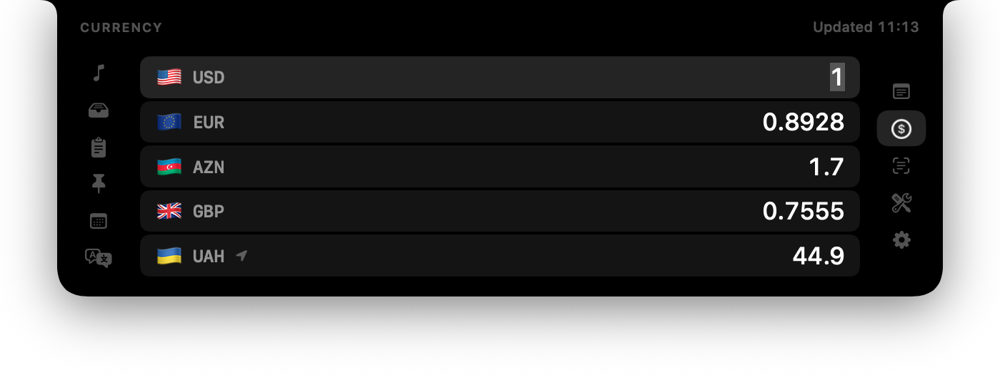

# Что изменено в этой версии

Это личная доработка [Cyclop](https://github.com/akalikbergenov/cyclop) от
akalikbergenov. Всё, что не перечислено ниже, работает как в оригинале.

## Как собрать и обновить

Нужна macOS 15 и Xcode (или Command Line Tools). Проект лучше держать в
локальной папке, не в iCloud Drive.

```bash
# первый раз
mkdir -p ~/Developer && cd ~/Developer
git clone https://github.com/jybronto/cyclop-my.git
cd cyclop-my

# каждый раз: закрыть Cyclop, затем
git pull && ./Scripts/bundle.sh && cp -R build/Cyclop.app /Applications/ && open /Applications/Cyclop.app
```

Собирать нужно скриптом `Scripts/bundle.sh`, а не кнопкой Run в Xcode: скрипт
кладёт в приложение помощник для вкладки «Музыка», переводы и подпись.

## Изменения

### Валюта: список из пяти валют вместо пары



- Пять строк вместо двух полей: по умолчанию USD, EUR, UAH, GBP и местная
  валюта. Вводить сумму можно в любой строке, остальные пересчитываются.
- У каждой валюты флаг (эмодзи). У криптовалют и прочих кодов без страны флага нет.
- Местная валюта отмечена стрелкой. По умолчанию берётся из региона в
  «Системных настройках → Язык и регион», разрешение на геолокацию не нужно.
  Её можно выбрать вручную или вернуть «по региону» тем же списком. Если
  местная валюта уже есть среди четырёх, отдельной строки нет, стрелка стоит у неё.
- Клик по флагу открывает список с поиском: флаг, код, страна и название
  валюты. Искать можно по любому из них («UAH», «Украина», «гривна»).
- В заголовке время последнего обновления курсов («Обновлено 10:58»); при
  наведении видна дата самих курсов. Курсы дневные, тот же источник, что и в оригинале.
- Курсы загружаются одной таблицей к доллару, так что пять валют стоят
  столько же запросов в сеть, сколько раньше две.

### Коды: двухфакторная аутентификация в панели

Перенесено из форка [arkashagr2-svg/cyclop](https://github.com/arkashagr2-svg/cyclop),
автор — Arkadij Grigorev; его коммиты взяты как есть, с авторством.

- Новая вкладка «Коды» (значок щита на правой колонке): одноразовые коды
  TOTP для нескольких аккаунтов, как в Google Authenticator.
- Перенос из Google Authenticator на iPhone одним QR: «Перенести аккаунты →
  Экспорт», скриншот QR, скопировать на Mac (универсальный буфер), нажать «+».
  Приедут все аккаунты сразу.
- Это разовый перенос, не синхронизация: новый аккаунт, добавленный на
  iPhone, нужно перенести ещё раз. Коды на обоих устройствах совпадают,
  потому что считаются из одного секрета и текущего времени.
- Можно добавить и по одному: ссылкой `otpauth://` или секретом.
- Секреты лежат в связке ключей macOS. После пересборки macOS может один раз
  спросить пароль для доступа к ней — подпись самосборной версии меняется.
- Сети вкладка не использует. Скопированный код не попадает в историю буфера;
  кнопка в шапке копирует код главного аккаунта одним нажатием.
- Вкладку можно убрать в «Настройки → Показывать в панели».
